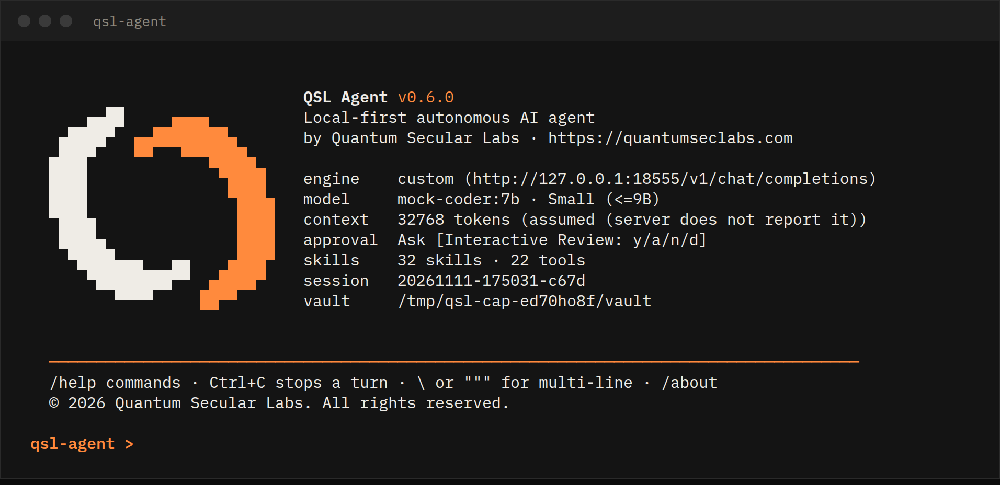

# QSL Agent

<div align="center">


**A fast, local-first autonomous AI agent, built natively in Rust.**

It runs on your own model (Ollama, LM Studio, llama.cpp, vLLM, or any OpenAI-compatible server) and, if you choose and accept a data-sharing notice, on hosted frontier models (OpenAI, Anthropic, Google, OpenRouter). It acts on your machine through guarded tools (approval gates and a SecurityGuard), and keeps its long-term memory as plain Markdown in your Obsidian vault.

Developed by **[Quantum Secular Labs](https://quantumseclabs.com/)** · [Changelog](CHANGELOG.md) · [Build & test kit](build-test/README.md)

</div>

---

## Contents

1. [Why QSL Agent](#why-qsl-agent)
2. [Quick Start](#quick-start)
3. [Installation](#installation)
4. [Using QSL Agent](#using-qsl-agent)
5. [How a Turn Works](#how-a-turn-works)
6. [Context Window Sizing](#context-window-sizing)
7. [Permissions & Security](#permissions--security)
8. [Memory, Sessions & Skills](#memory-sessions--skills)
9. [Supported Engines](#supported-engines)
10. [Reference: Command Line](#reference-command-line)
11. [Reference: REPL Commands](#reference-repl-commands)
12. [Reference: Tools](#reference-tools)
13. [Reference: Configuration](#reference-configuration)
14. [HTTP API & systemd Service](#http-api--systemd-service)
15. [Project Layout](#project-layout)
16. [Building & Testing](#building--testing)
17. [Troubleshooting](#troubleshooting)
18. [FAQ](#faq)
19. [About Quantum Secular Labs](#about-quantum-secular-labs)
20. [License](#license)

---

## Why QSL Agent

| | |
|:--|:--|
| **Local and private** | Prompts and files go only to the inference server you configure, which is local unless you choose a hosted frontier model and accept the data-sharing notice. No accounts, no telemetry. |
| **One small binary** | ~10 MB stripped, ~2 ms cold start, no Python runtime or virtualenv. |
| **Works with real local models** | Native tool calling where the model supports it, and automatic fallback to the Hermes `<tool_call>` text protocol where it doesn't. Malformed arguments are repaired and common argument-name mistakes accepted. |
| **Uses the context it needs** | Auto-sizes the context window for each model *and* machine, with a 32K minimum for agentic work. Older turns are summarised when the window fills up. |
| **Safe by default** | Destructive commands are hard-blocked, risky ones always need your approval, paths are checked after following symlinks, and every file edit can be rolled back. |
| **Remembers** | Facts, daily journals and skills live in your Obsidian vault as plain Markdown you can read and edit. |
| **Pleasant terminal UI** | Live token streaming, visible reasoning, structured ACTION / RESULT cards, a status line, tab completion, and Ctrl+C that stops the turn rather than the program. |
| **Scriptable** | One-shot mode, stdin input, `--json` output, exit codes, and an HTTP API. |

---

## Quick Start

```bash
# 1. Install and start a local engine (https://ollama.com), then pull a tool-capable model
ollama serve &
ollama pull qwen2.5-coder:7b

# 2. Install QSL Agent system-wide (Linux / macOS); Windows: see Installation below
curl -fsSL https://raw.githubusercontent.com/0x0806/qsl_agent/main/install.sh | bash

# 3. Check everything is connected, then start
qsl-agent --health-check
qsl-agent
```

On first run, QSL Agent writes `~/.config/qsl-agent/config.toml` with sensible defaults, finds your Obsidian vault (or creates `~/Documents/Obsidian_Vault`), and picks the first chat model on the engine.

---

## Installation

### One-line install (recommended)

Installs `qsl-agent` and a `qslagent` command (same program) so you can run either from anywhere.

**Linux / macOS** (x86_64 or arm64), system-wide in `/usr/local/bin` (uses `sudo` if needed):

```bash
curl -fsSL https://raw.githubusercontent.com/0x0806/qsl_agent/main/install.sh | bash
```

**Windows** (PowerShell). Run as Administrator for all users, or normally for the current user only:

```powershell
irm https://raw.githubusercontent.com/0x0806/qsl_agent/main/install.ps1 | iex
```

Both installers download the prebuilt binary for your platform from the latest GitHub release, verify its SHA-256, and fall back to building from source (needs Rust and git) if none is available. Options:

| Linux / macOS (`bash -s -- …`) | Windows (`-…`) | Effect |
|:--|:--|:--|
| `--version v0.6.0` | `-Version v0.6.0` | Install a specific release |
| `--user` | `-User` | Current user only (`~/.local/bin`, `%LOCALAPPDATA%\Programs`) |
| `--prefix DIR` | `-Prefix DIR` | Install into a custom directory |
| `--from-source` | `-FromSource` | Build with cargo instead of downloading |
| `--uninstall` | `-Uninstall` | Remove the binaries (config and vault are kept) |

```bash
curl -fsSL https://raw.githubusercontent.com/0x0806/qsl_agent/main/install.sh | bash -s -- --user
```

```powershell
& ([scriptblock]::Create((irm https://raw.githubusercontent.com/0x0806/qsl_agent/main/install.ps1))) -User
```

Re-running the installer upgrades an existing install. The manual build steps below are for contributors.

### Requirements

- Linux or macOS (x86_64 or arm64)
- Rust **1.89+**: `curl --proto '=https' --tlsv1.2 -sSf https://sh.rustup.rs | sh`
- A local inference engine with at least one model (see [Supported Engines](#supported-engines))
- Optional, for the test suite: `curl` and `python3`

### Build the release binary

Use whichever option suits you; all three produce the same optimised, stripped binary.

```bash
# A) Build kit (recommended): binary in build-test/bin/, prints size, checksum and startup time
./build-test/build.sh

# B) Plain cargo: binary in target/release/
cargo build --release --locked

# C) Into a Releases/ folder (ignored by git)
cargo build --release --locked
mkdir -p Releases && install -m 755 target/release/qsl-agent Releases/qsl-agent
```

### Install

```bash
sudo install -m 755 build-test/bin/qsl-agent /usr/local/bin/qsl-agent   # system-wide
# or
install -Dm755 build-test/bin/qsl-agent ~/.local/bin/qsl-agent           # current user only
```

The binary is self-contained. Once it is installed you can delete `target/` (`cargo clean`) to reclaim disk space.

### Update

```bash
cd qsl_agent && git pull && ./build-test/build.sh
sudo install -m 755 build-test/bin/qsl-agent /usr/local/bin/qsl-agent
```

Configs from earlier versions (including v0.2) keep working; new settings take their defaults. If you have several copies of the repository, run the binary from the one you just rebuilt. `qsl-agent --version` and the startup banner show which build you are using.

---

## Using QSL Agent

### Interactive

```bash
qsl-agent                 # new session
qsl-agent -C              # continue the most recent session
qsl-agent -r 2            # resume session #2 from /sessions
```

```text
                             QSL Agent v0.6.0
      ▄▄██     ▄▄▄▄          Local-first autonomous AI agent
   ▄████▀  ▄▄████████▄       by Quantum Secular Labs · https://quantumseclabs.com
  ▄███▀    ▀▀   ▀▀▀████▄
  ████              ▀████    engine    ollama (http://127.0.0.1:11434/api/chat)
  ████               ▀███▄   model     qwen2.5-coder:7b · Small (<=9B)
  ▀███▄               ████   context   32768 tokens (assumed (server does not report it))
   ████▄              ████   approval  Ask [Interactive Review: y/a/n/d]
    ▀████▄▄▄   ▄▄    ▄███▀   skills    32 skills · 22 tools
      ▀████████▀▀  ▄████▀    session   20261111-093000-a1b2
         ▀▀▀▀     ██▀▀       vault     /home/you/Documents/Obsidian_Vault


  ──────────────────────────────────────────────────────────────────────────────────────
  /help commands · Ctrl+C stops a turn · \ or """ for multi-line · /about
  © 2026 Quantum Secular Labs. All rights reserved.

```



The mark is the QSL "Split state" ring in two colours: the terminal's own foreground for one half and the QSL accent orange (`#ff8a3d`; 256-colour and 16-colour fallbacks) for the other. The logo is never printed in `--json`, `--quiet`, piped or `NO_COLOR` output, and terminals narrower than 74 columns get a compact header. `/about` shows company, licence and notice information.

qsl-agent > find every TODO in this repo and group them by file
```

- **Multi-line input:** end a line with `\`, or wrap the text in `"""`.
- **Tab** completes commands and their arguments.
- **Ctrl+C** interrupts the running turn and kills any command it started; press it twice within 2 seconds to force quit.
- Start a line with `//` to send text that begins with `/`.

### One-shot and scripting

```bash
qsl-agent "summarise the README in this folder"            # positional prompt
qsl-agent -P "fix the failing test in tests/api.rs"
git diff | qsl-agent -q "write a conventional commit message"   # stdin is appended as context
cat notes.txt | qsl-agent -P -                             # the prompt itself comes from stdin
qsl-agent --json "list the TODOs" | jq -r .reply           # machine-readable output
```

One-shot runs are non-interactive. Risky shell commands are denied with an explanation the model can act on, unless you pass `--yolo` (use that only in disposable environments).

Exit codes: `0` success · `1` agent or engine error · `2` usage error · `130` interrupted.

---

## How a Turn Works

Each turn is an adaptive ReAct (reason → act → observe) loop:

1. **Think:** the model streams its reasoning (shown live in the REASONING frame) and either answers or requests tool calls.
2. **Act:** tool calls are parsed and repaired, checked by the SecurityGuard, approved by you where needed, then executed. Independent read-only calls run in parallel.
3. **Observe:** results go back to the model (large outputs keep their head and tail), and the loop continues.

Built-in safeguards:

- **Step budget** (`max_react_steps`, default 35). Two steps before the limit the model is told to wrap up. At the limit you choose `[c]` extend by 15 steps, `[f]` force a final answer, or `[s]` stop. Headless runs extend once, then force a tool-free final answer, so you always get a reply.
- **Repetition guard:** a repeated identical call gets a warning; the third identical call is blocked.
- **Self-healing:** truncated tool JSON leads to a retry in smaller pieces, empty or reasoning-only replies get a targeted nudge, and an engine-reported context overflow triggers compaction and a retry.
- **Sub-agents:** `delegate_task` runs a self-contained subtask in a fresh context and returns a report.
- **Planning:** the `todo` tool keeps a visible task plan for multi-step work (`/todo` shows it).

After every turn a status line summarises the cost:

```text
  [31.5s | 4 steps | 3 tools | ctx 4.0k/262.1k 2% | in 15.7k out 356 (11 tok/s)]
```

---

## Context Window Sizing

Agentic work needs room. The system prompt and tool schemas alone take about 4K tokens, and every file read or command output adds more. QSL therefore **never runs below `min_context_size` (default 32K)**: smaller explicit values are raised to it.

With `context_size = 0` (the default), QSL picks the largest window that:

1. the model supports (read from Ollama's `/api/show`),
2. is at most `max_context_size` (default 256K), and
3. **fits in this machine's free RAM + GPU memory.** The KV-cache cost per token is computed from the model's architecture, so the same default stays safe on an 8 GB laptop and generous on a workstation.

The banner and `--health-check` show the chosen size and why, for example `262144 tokens (auto)` or `20480 tokens (auto, limited by memory (11.3 GiB usable))`.

| Model type | KV cache per token | 256K window needs |
|:--|:--|:--|
| Hybrid attention (Qwen3.5, Qwen3-Next) | ~32 KB | ~8 GB + weights |
| Dense GQA (Llama-3.1-8B, Qwen2.5-7B) | ~128 KB | ~32 GB + weights |

Measured on an RTX 3050 6 GB laptop with Qwen3.5-9B Q4: 16K = 6.0 GB at 32 tok/s · 64K = 7.8 GB at 27 tok/s · 256K = 14.9 GB at 21 tok/s.

**If the window falls below the minimum**, QSL warns and suggests a fix: free some memory, use a smaller quantization, or enable KV-cache quantization on the Ollama server (`OLLAMA_KV_CACHE_TYPE=q8_0` with `OLLAMA_FLASH_ATTENTION=1` halves KV memory). Very short-context models (8K) should be replaced with long-context ones.

**LM Studio, llama.cpp and vLLM** fix the context when the model is loaded. QSL reads the server's real value (`/api/v0/models`, `/props`) and tells you how to raise it: the "Context Length" setting in LM Studio, `llama-server -c 65536`, or `vllm --max-model-len 65536`.

---

## Permissions & Security

### Approval modes

Set the mode with `-a <mode>`, `/approval <mode>` or `approval_mode` in the config.

| Mode | Normal mutating tools (write, edit, shell, …) | Risky commands (rm, sudo, git push, installs, kill, …) |
|:--|:--|:--|
| `ask` *(default)* | Prompt: `[y]` once · `[a]` for the session · `[n]` deny · `[d]` deny for the session | Prompt every time (`[a]` is not offered) |
| `always` | Automatic | Prompt every time |
| `strict` | Prompt every time | Prompt every time |
| `yolo` | Automatic | Automatic (**sandboxes only**) |

Read-only tools never prompt. Writing a memory or creating a skill only touches the agent's own vault area, so these don't prompt in `ask` mode. **Pressing Enter means deny.** When a prompt is shown, the review card replaces the usual ACTION card:

```text
╭── [PERMISSION REVIEW] ────────────────────────────────────────────────
│  Tool:      execute_command
│  Command:   rm build/old.log
│  Risk:      deletes files
├───────────────────────────────────────────────────────────────────────
│  [y] Allow once  │  [n] Deny  │  [d] Deny (session)
╰───────────────────────────────────────────────────────────────────────
  permission [y/a/n/d] (default n) >
```

### SecurityGuard

- **Hard-blocked in every mode:** recursive deletion of `/`, `~`, `.` or `*`; `mkfs`; partition editors; raw writes to disks; fork bombs; `curl … | sh` and similar remote execution; base64 payloads piped to a shell; `/dev/tcp` reverse shells; reading `/etc/shadow` or SSH private keys; shutdown/reboot; firewall flushes; erasing shell history. Line continuations are normalised before checking, so splitting a command across lines doesn't evade these rules.
- **Review tier (25 rules):** deleting files, `sudo`/`su`, `git push`/`reset --hard`, package installs, `kill`, service changes, permission changes, uploads, `ssh`/`scp`, and more.
- **Paths** are normalised and symlinks are followed before checking. Sensitive files (SSH keys, `~/.aws/credentials`, `~/.kube/config`, `~/.netrc`, `~/.gnupg/`, `/etc/shadow`, …) cannot be read. System directories (`/etc`, `/usr`, `/boot`, `/sys`, …) cannot be written. The agent cannot rewrite its own config file. Set `allowed_roots` to confine file tools to specific directories.
- **Commands** run in their own process group with a timeout (`command_timeout_secs`); a timeout or Ctrl+C kills the whole process tree.
- **Checkpoints:** every file written or edited is backed up first. `/rollback` undoes the last turn's file changes. Shell side effects are not tracked.
- **Secret redaction:** private keys and common API tokens are masked in displayed output, memories and journals.

---

## Memory, Sessions & Skills

### Obsidian vault

```
<vault>/QSL_Agent/
├── Profile.md              # user and host profile (loaded into every session)
├── Memories.md             # one fact per bullet
├── Daily/2026-11-04.md     # journal of every turn
├── Architecture/  Security/  Research/
└── Skills/<name>/SKILL.md  # built-in and agent-created skills
```

- **Vault discovery** checks, in order: `-v`/`obsidian_vault_path`, `$OBSIDIAN_VAULT`, the Obsidian app registry (including Flatpak), `~/Documents/*`, `~/Obsidian`, `~/Notes`, `~/Vault`, home sub-folders, and the current directory. `/vault auto` re-detects.
- **Memory:** recent facts are placed in the system prompt; older ones are reachable with `memory_search`. The agent saves durable facts itself (duplicates are skipped) and can correct them with `memory_forget`. You can use `/remember`, `/forget` and `/memory [query]`.
- **Note paths** are confined to the vault; `..`, absolute paths and hidden folders are rejected.

### Sessions

Every conversation is saved atomically to `~/.local/state/qsl-agent/sessions/<id>.jsonl`, including the summary of any compacted turns.

| Action | How |
|:--|:--|
| Continue the last session | `qsl-agent -C` |
| List, resume or delete | `/sessions`, `/resume 3`, `/sessions rm <id>` |
| Rewind or redo | `/undo [n]`, `/retry` |
| Export | `/export md` or `/export json path/to/file` |
| Search past conversations | the agent's `session_search` tool |

### Skills

Skills are Markdown playbooks (`SKILL.md` with YAML frontmatter). Only their names and descriptions go into the prompt; the model loads full instructions with `skill_read` when needed, and you can pin one with `/use <skill>`.

Skills are loaded from, in priority order: `./.qsl/skills/`, `./skills/`, `~/.config/qsl-agent/skills/`, and `<vault>/QSL_Agent/Skills/`. After solving a reusable workflow the agent can save it with `skill_create`.

**32 built-in skills:** `api-design`, `benchmark`, `code-review`, `codebase-inspection`, `data-analysis`, `data-transform`, `database-sql`, `debug`, `dependency-update`, `doc-writer`, `docker-container`, `explain-code`, `file-organizer`, `git-workflow`, `incident-response`, `markdown-docs`, `migration`, `network-diagnostics`, `obsidian-vault-manager`, `python-env`, `qsl-security-audit`, `refactor`, `rust-cargo`, `security-audit`, `shell-script`, `software-development`, `sql-query`, `system-ops`, `test-writer`, `text-processing`, `web-research`, `yaml-toml-config`.

### QSL Security Audit

`qsl-security-audit` is a bundled, multi-file skill for source-first security audits. It runs in two modes: *guidance* (answer a security question or review one area) and *full audit* (six phases: reconnaissance, coverage-led hunting, adversarial candidate validation, structured `findings.json`, independent record verification, and a target-neutral report). Findings are `confirmed` (complete source trace and a bounded observed result), `needs_validation` (an exact unresolved fact, no severity) or `rejected`. Two zero-dependency Node.js validators check `coverage-ledger.json` and `findings.json` against a JSON schema.

```text
qsl-agent "security audit this repository, output to ~/qsl-audits/myproject"
```

How it maps onto QSL Agent:

- The skill is seeded to `<vault>/QSL_Agent/Skills/qsl-security-audit/` (`SKILL.md` plus 21 companion files, including the licence text). `skill_read` pages long files (`part=N`) and reads companions with `file="HUNTING.md"`; a pinned skill (`/use`) is capped at 6,000 characters.
- "Delegated agents" are `delegate_task` calls. Sub-agents start with a fresh context, run one at a time and cannot delegate further.
- Full audit mode needs **Node.js** for the validators. Without it, guidance mode still works.
- **QSL Agent ships no OS-level sandbox.** The skill's safety rules therefore apply as written: target code is not executed unless you confirm an external sandbox that meets every control, and such leads are reported as `needs_validation`. Source reading is always allowed.
- Models with a small context window should use the `quick` profile or a scoped run, and load one companion file at a time.
- The skill-reading path is tested end to end against a scripted model; a full audit has **not yet been validated with a real local model**, so treat first audits as trials.
- Findings are produced by your local model and must be reviewed by a person before you act on them. This is a decision aid, not a certification or a compliance assessment.

The methodology derives from an MIT-licensed upstream skill; its licence and provenance are in [THIRD_PARTY_NOTICES.md](THIRD_PARTY_NOTICES.md).

### Project instructions

If the working directory contains `AGENTS.md`, `QSL.md`, `.qsl/instructions.md` or `CLAUDE.md`, the file is loaded into the system prompt automatically. Use it to describe build commands, conventions and constraints for a repository.

---

## Supported Engines

| Provider | Default endpoint | Protocol |
|:--|:--|:--|
| `ollama` *(default)* | `http://127.0.0.1:11434` | Native `/api/chat`: applies `num_ctx`, streams `thinking` |
| `lmstudio` | `http://127.0.0.1:1234/v1` | OpenAI-compatible SSE |
| `custom` | `-e URL` / `custom_url` | OpenAI-compatible SSE: llama.cpp, vLLM, LocalAI, … (a remote URL needs the data-sharing consent below) |
| `openai` · `anthropic` · `gemini` · `openrouter` | built-in preset | Hosted frontier models, see [Hosted frontier models](#hosted-frontier-models-optional) |

```bash
qsl-agent -p lmstudio
qsl-agent -e http://127.0.0.1:8080/v1 -m my-model                # llama-server
QSL_API_KEY=sk-... qsl-agent -e https://openrouter.ai/api/v1 -m qwen/qwen3-coder
```

- If no model is set, the first chat model on the engine is used (embedding models are skipped).
- Models that lack native tool calling switch automatically to the `<tool_call>` text protocol; `/tools` shows which mode is active.
- Reasoning output (`<think>` tags, `reasoning_content`, Ollama `thinking`) is shown live; toggle it with `/think`.
- Transient errors (connection refused, 429, 5xx) are retried with exponential backoff.
- Switch at runtime with `/models`, `/model <name>` and `/provider <name> [url]`.

Recommended models: tool-capable instruction models such as **Qwen2.5/Qwen3 Coder**, **Qwen3.5**, **Llama 3.1+** or **Mistral Small**. On 6–8 GB GPUs, 7–9B models at Q4 work well.

---

## Hosted frontier models (optional)

QSL Agent is local-first, and it stays that way unless you switch. You can point it at a hosted frontier model with one command, and switch back just as easily:

```text
qsl-agent > /provider                 # list local engines and hosted presets
qsl-agent > /provider anthropic       # shows the data-sharing notice, asks for "yes"
qsl-agent > /models                   # then /model <name>
qsl-agent > /provider ollama          # back to local: data stays on your machine
```

| Preset | Service | Key variable | Endpoint |
|:--|:--|:--|:--|
| `openai` | ChatGPT models (OpenAI API) | `OPENAI_API_KEY` | `https://api.openai.com/v1` |
| `anthropic` | Claude models (Anthropic API, OpenAI-compatible endpoint) | `ANTHROPIC_API_KEY` | `https://api.anthropic.com/v1` |
| `gemini` | Gemini models (Google AI API, OpenAI-compatible endpoint) | `GEMINI_API_KEY` | `https://generativelanguage.googleapis.com/v1beta/openai` |
| `openrouter` | Many vendors' models through OpenRouter | `OPENROUTER_API_KEY` | `https://openrouter.ai/api/v1` |

**Your data leaves your machine.** While a hosted engine is selected, what you type, the contents of files the agent reads, command output and tool results are sent over the internet to that company, under its terms, privacy policy and retention rules, which Quantum Secular Labs does not control. Usage may be billed to your account with them.

How QSL Agent handles that:

- **Explicit consent, per service.** Switching shows a notice naming the company and host and needs you to type `yes`. The acceptance is remembered per host in `cloud_consent` in your config. Until it exists, the client refuses to send any request.
- **Headless runs and the HTTP API** (`-q`, `--json`, `--serve`) cannot ask, so they exit with code 2 unless you pass `--accept-cloud` (or set `QSL_ACCEPT_CLOUD=1`), which applies to that run only and is never saved.
- **Any non-local endpoint counts,** including `custom` URLs and `-e`. Loopback, private LAN and `.local` addresses count as local.
- **Keys come from the environment** (`OPENAI_API_KEY` and the others, or `QSL_API_KEY`). Keys from the environment or `--api-key` are never written to the config file.
- **Secrets are masked in tool output before it is sent to a hosted model** (private keys and common API tokens). Masking is best effort. It does not cover what you type or the contents of files you ask the agent to quote.
- The banner shows `hosted  data is sent to <host>` whenever a hosted engine is active.

What the vendors say, from their published documentation (checked 2026-11-11; these change, so read the current terms):

| Service | Training on API data | Retention | Source |
|:--|:--|:--|:--|
| OpenAI | Not used to train models unless you opt in | Abuse-monitoring logs up to 30 days by default; zero data retention needs approval | [Data controls](https://developers.openai.com/api/docs/guides/your-data) |
| Anthropic | Commercial API data not used for training by default | Deleted within 30 days; longer if flagged for policy violations or by agreement | [Retention](https://privacy.claude.com/en/articles/7996866-how-long-do-you-store-my-organization-s-data), [Training](https://privacy.claude.com/en/articles/7996868-is-my-data-used-for-model-training) |
| Google (Gemini API) | Unpaid quota: content may be used to improve products and reviewed by humans. Paid quota: not used to improve products | Paid: logged for a limited period to detect abuse | [Additional Terms](https://aistudio.google.com/docs/terms) |
| OpenRouter | Depends on the underlying provider; account settings can restrict routing | Per provider | [Privacy and logging](https://openrouter.ai/docs/features/privacy-and-logging) |

Notes: Anthropic and Google describe their OpenAI-compatible endpoints as a compatibility layer (Anthropic: primarily for testing and comparison, with some request fields ignored; Google: beta). Native tool calling and streaming are supported on both. Hosted models usually have much larger context windows than QSL Agent assumes when the server does not report one; set `context_size` in the config.

---

## Reference: Command Line

```text
Usage: qsl-agent [OPTIONS] [PROMPT]...

  [PROMPT]...                     One-shot task (same as -P)
  -P, --prompt <PROMPT>           Non-interactive prompt ("-" reads stdin)
  -m, --model <MODEL>             Model name
  -p, --provider <PROVIDER>       ollama | lmstudio | custom
  -e, --endpoint <URL>            OpenAI-compatible endpoint (implies --provider custom)
      --accept-cloud              Accept, for this run only, that a hosted engine receives your data (QSL_ACCEPT_CLOUD=1)
      --api-key <KEY>             Bearer token for remote endpoints        [env: QSL_API_KEY]
  -v, --vault <PATH>              Obsidian vault
  -a, --approval <MODE>           ask | always | strict | yolo
      --yolo                      Same as --approval yolo
  -t, --temperature <T>           Sampling temperature 0.0 - 2.0
  -c, --context-size <N>          Context window (0 = auto)
      --max-steps <N>             ReAct steps per turn
      --config <PATH>             Config file                              [env: QSL_CONFIG]
  -C, --continue                  Continue the most recent session
  -r, --resume <ID>               Resume a session (id, prefix or list number)
      --no-stream                 Disable token streaming
      --no-color                  Disable colours (NO_COLOR is also honoured)
  -q, --quiet                     One-shot: print only the final answer
      --json                      One-shot: print a JSON result
      --serve [ADDR]              HTTP API (default 127.0.0.1:8765)
      --list-models               List models on the engine and exit
      --list-sessions             List saved sessions and exit
      --show-config               Print the active configuration and exit
      --health-check              Run diagnostics; non-zero exit code on failure
      --verbose                   Debug log to <state_dir>/qsl-agent.log
  -h, --help / -V, --version
```

---

## Reference: REPL Commands

| Command | Description |
|:--|:--|
| `/help` | Command manual |
| `/health` | Engine, models, context, vault, skills, state and host-tool diagnostics |
| `/models` · `/model <name>` | List or switch models (the conversation is kept) |
| `/provider <p> [url]` | Switch engine |
| `/approval <mode>` (`/mode`) | `ask` · `always` · `strict` · `yolo` |
| `/vault [path\|auto]` | Show or switch the Obsidian vault |
| `/memory [query]` · `/remember <fact>` · `/forget <text>` | Long-term memory |
| `/skills` · `/skill <name>` · `/use <name\|off>` | Skill catalog, instructions, pinning |
| `/todo` | Current task plan |
| `/sessions [rm <id>]` · `/resume <id\|#>` · `/new` (`/clear`) · `/title <text>` | Sessions |
| `/undo [n]` · `/retry` | Rewind turns · re-run the last prompt |
| `/rollback` · `/checkpoints` | Undo the last turn's file changes · list backups |
| `/compact` | Summarise older context now |
| `/export [md\|json] [path]` | Export the conversation |
| `/usage` (`/stats`) | Token and session statistics |
| `/think on\|off` · `/stream on\|off` | Display toggles |
| `/tools` | Tools and tool-calling mode |
| `/cd <dir>` | Change the working directory |
| `/provider` | `[name] [url]` List engines, or switch (hosted engines show a data-sharing notice) |
| `/config` | Show the active configuration (secrets masked) |
| `/about` | Company, licence and version information |
| `/exit` (`/quit`) | Exit |

---

## Reference: Tools

| Tool | Kind | Purpose |
|:--|:--|:--|
| `execute_command` | mutating | Shell command; optional `workdir` and `timeout` |
| `read_file` | read | Text file; optional `start_line` / `end_line` |
| `write_file` | mutating | Create or overwrite a file (atomic, checkpointed) |
| `append_file` | mutating | Append to a file (for building large files) |
| `edit_file` | mutating | Replace an exact, unique snippet (`replace_all` optional, whitespace-tolerant fallback) |
| `list_dir` | read | Directory listing with sizes, `depth` 1–3 |
| `search_files` | read | Regex search across files (`glob`, `ignore_case`) |
| `find_files` | read | Find files by glob |
| `todo` | read | Task plan for multi-step work |
| `obsidian_search` · `obsidian_read` · `obsidian_list` | read | Vault access |
| `obsidian_write` | mutating | Create, overwrite or append a note |
| `obsidian_append` | mutating* | Save a long-term memory |
| `memory_search` · `memory_forget` | read · mutating | Query or correct memories |
| `skill_list` · `skill_read` · `skill_create` | read · read · mutating* | Skills |
| `session_search` | read | Search past conversations |
| `web_fetch` | read | HTTP GET with HTML-to-text (disable with `allow_web = false`) |
| `delegate_task` | read | Run a sub-agent on a self-contained subtask |

\* Writes only into the agent's own vault area, so it doesn't prompt in `ask` mode.

---

## Reference: Configuration

The config file is `~/.config/qsl-agent/config.toml` (override with `--config` or `$QSL_CONFIG`). Every key is optional. See [`config.example.toml`](config.example.toml) for a commented template.

| Key | Default | Meaning |
|:--|:--|:--|
| `provider` | `"ollama"` | `ollama` · `lmstudio` · `custom` |
| `ollama_url` / `lmstudio_url` / `custom_url` | local defaults | Engine endpoints |
| `api_key` | — | Bearer token for remote endpoints (or `QSL_API_KEY`) |
| `api` | `"auto"` | Wire protocol: `auto` · `openai` · `ollama` |
| `model` | `""` | Model name; empty means auto-detect |
| `obsidian_vault_path` | `""` | Empty means auto-detect |
| `temperature` | `0.2` | Sampling temperature |
| `max_tokens` | `4096` | Reply budget (capped at ¼ of the context) |
| `context_size` | `0` | `0` = auto (see [Context Window Sizing](#context-window-sizing)) |
| `min_context_size` | `32768` | Agentic floor |
| `max_context_size` | `262144` | Ceiling for auto mode |
| `stream` · `show_reasoning` | `true` · `true` | Display options |
| `max_react_steps` | `35` | Step budget per turn |
| `compaction_threshold` | `0.75` | Fill level at which older turns are summarised |
| `parallel_tools` | `true` | Run independent read-only calls concurrently |
| `project_context` | `true` | Load `AGENTS.md` / `QSL.md` / … from the working directory |
| `approval_mode` | `"ask"` | `ask` · `always` · `strict` · `yolo` |
| `command_timeout_secs` | `60` | Default shell timeout |
| `max_tool_output_chars` | `12000` | Per-result cap sent to the model |
| `allow_web` | `true` | Enable `web_fetch` |
| `allowed_roots` | `[]` | Confine file tools, e.g. `["~/projects"]` |
| `request_timeout_secs` | `600` | Maximum wait between streamed chunks |
| `max_retries` | `3` | Retries for transient engine errors |
| `save_sessions` | `true` | Persist conversations |
| `state_dir` | XDG state dir | Sessions, checkpoints, logs, REPL history |

**Precedence:** command-line flags › environment (`QSL_PROVIDER`, `QSL_MODEL`, `QSL_ENDPOINT`, `QSL_API_KEY`, `QSL_APPROVAL`, `OBSIDIAN_VAULT`) › config file › defaults. An invalid config is backed up to `config.toml.bak` and replaced with defaults, with a warning showing the parse error.

---

## HTTP API & systemd Service

```bash
QSL_API_TOKEN=change-me qsl-agent --serve 127.0.0.1:8765

curl -s localhost:8765/v1/chat \
  -H 'authorization: Bearer change-me' -H 'content-type: application/json' \
  -d '{"message": "what changed in git today?"}'
```

| Endpoint | Request → response |
|:--|:--|
| `POST /v1/chat` | `{"message", "session_id"?, "new_session"?}` → `{"ok", "reply", "session_id", "steps", "tool_calls", "elapsed_ms", "tokens_in", "tokens_out"}` |
| `GET /health` | Engine status, model, context size, current session |
| `GET /v1/sessions` | Saved sessions |

Requests are processed one at a time and run non-interactively, so risky commands are denied. Binding to a non-loopback address requires `QSL_API_TOKEN`.

To run the API as a systemd user service:

```bash
install -Dm644 systemd/qsl-agent.service ~/.config/systemd/user/qsl-agent.service
systemctl --user edit qsl-agent          # set QSL_API_TOKEN and the vault path
systemctl --user enable --now qsl-agent
```

---

## Project Layout

```
qsl_agent/
├── src/
│   ├── main.rs            CLI flags, startup, one-shot / REPL / server dispatch
│   ├── agent.rs           ReAct loop, tool orchestration, compaction, sub-agents
│   ├── provider.rs        OpenAI-compatible + Ollama-native clients, streaming parsers, retries
│   ├── sizing.rs          Context window planning (model metadata x machine memory)
│   ├── context.rs         Token estimates, history repair, compaction boundaries
│   ├── tools/             Tool schemas + implementations (fs, shell, web)
│   ├── security.rs        Command tiers, path policy, secret redaction
│   ├── approval.rs        Permission prompts and modes
│   ├── memory.rs          Obsidian vault memory and journals
│   ├── skills.rs          Skill loading, paging and creation (+ skills_builtin.rs, skills_bundle.rs)
│   ├── skills_bundles/    Folder skills embedded in the binary (qsl-security-audit)
│   ├── brand.rs           QSL mark (half-block art), palette and company facts
│   ├── session.rs         Session persistence, search, export
│   ├── checkpoint.rs      File backups for /rollback
│   ├── ui.rs · cli.rs     Terminal UI, streaming renderer, REPL
│   ├── server.rs          HTTP API
│   └── config.rs · interrupt.rs · util.rs
├── tests/                 End-to-end tests + shared mock LLM
├── examples/mock_llm.rs   Standalone mock inference server
├── build-test/            Build, test, smoke and live-test scripts
├── scripts/               gen_logo.py (terminal mark), capture_ui.py (real UI screenshots)
├── docs/screenshots/      Screenshots captured from the real binary
├── systemd/               User service unit for the HTTP API
├── config.example.toml    Commented configuration template
├── THIRD_PARTY_NOTICES.md Licence text for bundled third-party material
└── CHANGELOG.md
```

---

## Building & Testing

```bash
./build-test/all.sh      # everything below, in order
./build-test/build.sh    # optimised, stripped binary -> build-test/bin/qsl-agent
./build-test/test.sh     # cargo fmt --check, clippy -D warnings, unit + end-to-end tests
./build-test/smoke.sh    # the built binary vs. a scripted mock LLM, incl. the interactive REPL in a pseudo-terminal
./build-test/live.sh     # optional: a real tool-using task against your local model
```

| Suite | Coverage |
|:--|:--|
| Unit tests (99) | Parsers, security rules, path policy, sizing, compaction, tools, config, UI rendering |
| End-to-end tests (18) | The real binary against a mock server over both the OpenAI SSE and Ollama NDJSON protocols: tool round-trips, parallel calls, security tiers, text-protocol fallback, memory, sessions, compaction, HTTP API |
| Skill validators (65) | The bundled security-audit validators' own test suite (`node --test`, needs Node.js) |
| Smoke tests (22) | CLI flags, one-shot runs, stdin input, sessions, memory, HTTP auth |
| PTY suite (33) | Banner, streaming, permission prompts, deny and rollback, Ctrl+C interruption, completion, multi-line input |

All suites use a throwaway `HOME`, so they never touch your real config, vault or sessions. Logs go to `build-test/out/`. You can also run the mock server by hand to try the UI without a model:

```bash
cargo run --example mock_llm -- 18080
qsl-agent -e http://127.0.0.1:18080/v1 -m mock-coder:7b
```

---

## Troubleshooting

| Symptom | Fix |
|:--|:--|
| `cannot reach local AI engine` | Start the engine (`ollama serve`; in LM Studio, start the server) and run `qsl-agent --health-check` |
| `no model configured and none detected` | `ollama pull qwen2.5-coder:7b`, or `/model <name>` |
| `exceeds the available context size` / context warning in the banner | Check row 3 of `--health-check`. Make sure you are running the latest build (`qsl-agent --version`), free RAM/VRAM, set `OLLAMA_KV_CACHE_TYPE=q8_0`, or raise the server's context in LM Studio / llama.cpp |
| Model prints JSON instead of calling tools | Handled automatically by the text-protocol fallback; tool-capable models give better results |
| `[SECURITY BLOCKED]` | The command matched a hard-deny rule. Run it yourself if you really mean it |
| `DENIED ... non-interactive mode` | Risky commands need a human: run interactively, or use `--yolo` inside a sandbox |
| Slow first response | Prompt processing on a small GPU. The system prompt stays stable, so the engine caches it after the first step |
| Step limit reached | Press `[c]` to add 15 steps, or raise `max_react_steps` / `--max-steps` |
| Config errors | Check the warning printed at startup; the broken file is saved as `config.toml.bak` |
| Need more detail | `qsl-agent --verbose`, then read `~/.local/state/qsl-agent/qsl-agent.log` |

---

## FAQ

**Does anything leave my machine?**
Only requests to the inference server you configure, plus `web_fetch` requests the agent makes (disable them with `allow_web = false`). There is no telemetry.

**Which model should I use?**
A tool-capable instruction model with a long context, such as Qwen2.5/Qwen3 Coder, Qwen3.5 or Llama 3.1+. Larger models plan better; 7–9B models are fine for everyday tasks.

**Is 256K context required?**
No. 32K is the minimum for agentic work, and QSL uses more automatically when the model and your memory allow it. Long sessions are summarised, so you don't run out of room.

**Can I undo what the agent did?**
File writes and edits: yes, with `/rollback`. Shell commands can't be undone, which is why risky ones always need your approval.

**Can I use a cloud model?**
Yes: `/provider openai|anthropic|gemini|openrouter`, or any OpenAI-compatible endpoint. Your prompts, file contents the agent reads and command output then leave your machine, and you must accept a notice naming the company first. See [Hosted frontier models](#hosted-frontier-models-optional).

**My old v0.2 config / vault / skills?**
All are picked up unchanged. Skills you edited are never overwritten by the built-in copies. The one exception is a bundled folder skill (`qsl-security-audit`) whose `SKILL.md` still has the `managed: qsl-agent` line: it is refreshed when the bundled version changes. Delete that line to keep your edits.

---

## About Quantum Secular Labs

**[Quantum Secular Labs](https://quantumseclabs.com/)** (QuantumSec Labs) is a specialized cybersecurity and technology engineering firm focused on digital infrastructure defense, enterprise vulnerability assessment and penetration testing (VAPT), offensive security auditing, and applied Artificial Intelligence research.

QSL engineered **QSL Agent** to directly eliminate the security vulnerabilities, secret leakage, and compliance hazards inherent in cloud-tethered AI tools. By uniting defensive cybersecurity principles with native Rust systems engineering, QSL Agent provides developers, security auditors, and enterprises with an autonomous, sovereign local intelligence engine purpose-built for zero-trust environments.

---

## License

QSL Agent is released under the **[QSL Team Source-Available License v1.0 (2026)](LICENSE)** by **[Quantum Secular Labs](https://quantumseclabs.com/)**.

- **Source-Available**: You may view, inspect, audit, compile, and run the software locally on your own hardware for personal, academic, or internal operational use.
- **Strictly Non-Redistributable**: You may **NOT** redistribute, resell, mirror, syndicate, sub-license, fork publicly, or distribute pre-compiled binaries or packages to any third party without explicit prior written authorization from Quantum Secular Labs.
- **Commercial & Cloud Exclusivity**: Providing QSL Agent as a hosted service (SaaS/PaaS/API wrapper) or commercial redistribution is reserved exclusively to **[Quantum Secular Labs](https://quantumseclabs.com/)**.
- **All Rights Reserved**: All copyrights, patents, and distribution rights remain solely with Quantum Secular Labs.
